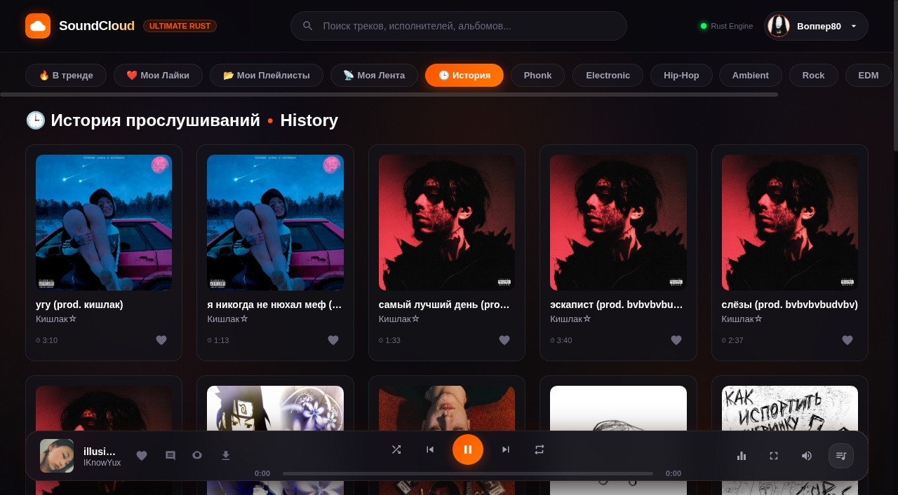

# ☁️ SoundCloud Ultimate — Suite

[](https://github.com/masyaslasher/soundcloud-ultimate/releases/latest)
[](https://www.rust-lang.org/)
[]()
[](LICENSE)
[]()
[]()

> **SoundCloud Ultimate** — ультимативный клиент нового поколения для прослушивания SoundCloud.
> Сочетает премиальный дизайн **AMOLED Bento Glass** (`#0A090E`, неоновые оранжевые лазерные акценты `#FF5500`), нативную скорость движка на Rust, встроенный 5-полосный студийный эквалайзер, 100% In-App социальную среду и **встроенный Zapret Anti-DPI обход блокировок для РФ без необходимости в стороннем VPN**.

---

## ⚡ Встроенный Zapret Anti-DPI (Работает в РФ без VPN!)

Приложение содержит полностью автономный встроенный Anti-DPI движок на чистом Rust (без установки драйверов WinDivert, ByeDPI или внешних утилит):
- 🛡️ **TLS ClientHello Record Splitting:** Разбивает начальный TLS-пакет на позиции `split-pos=2` со сбросом TCP-окна (`TCP_NODELAY` + 5ms push), в результате чего ТСПУ РКН не может обнаружить SNI заблокированных доменов (`*.sndcdn.com`, `api-v2.soundcloud.com`, `*.soundcloud.cloud`).
- 🌐 **Cloudflare & Google DoH (DNS-over-HTTPS):** Встроенный защищенный резолвер DNS через HTTPS, полностью предотвращающий DNS-спуфинг и подмену IP-адресов интернет-провайдерами.
- 🎵 **Прозрачный стриминг аудио и HLS:** Все плейлисты `.m3u8` и аудио-сегменты (`.m4s`, `.aac`, `.mp3`) проксируются локальным сокетом. Звук играет мгновенно, без задержек и заиканий.

---

## 📦 Быстрая загрузка / Downloads (v1.1.0)

Готовые скомпилированные релизы доступны во вкладке [**GitHub Releases**](https://github.com/masyaslasher/soundcloud-ultimate/releases/latest):

| Платформа | Файл | Инструкция по запуску |
| :--- | :--- | :--- |
| 🪟 **Windows Portable** | [**`SoundCloud-Ultimate-Windows-x86_64-Portable.zip`**](https://github.com/masyaslasher/soundcloud-ultimate/releases/latest) | Распаковать архив и запустить `soundcloud-desktop.exe` (не требует прав администратора) |
| 🪟 **Windows .EXE** | [**`SoundCloud-Ultimate-Portable.exe`**](https://github.com/masyaslasher/soundcloud-ultimate/releases/latest) | Автономный исполняемый файл для Windows |
| 🐧 **Linux AppImage** | [**`SoundCloud-Ultimate-x86_64.AppImage`**](https://github.com/masyaslasher/soundcloud-ultimate/releases/latest) | `chmod +x SoundCloud-Ultimate-x86_64.AppImage` и запустить двойным кликом или в терминале |
| 🐧 **Debian / Ubuntu** | [**`soundcloud-ultimate_1.1.0_amd64.deb`**](https://github.com/masyaslasher/soundcloud-ultimate/releases/latest) | Установить пакет: `sudo dpkg -i soundcloud-ultimate_1.1.0_amd64.deb` |
| 🐧 **Linux Standalone** | [**`soundcloud-ultimate-linux-x86_64.tar.gz`**](https://github.com/masyaslasher/soundcloud-ultimate/releases/latest) | Распаковать: `tar -xvf soundcloud-ultimate-linux-x86_64.tar.gz && ./run.sh` |
| 🧩 **Chrome Extension** | [**`soundcloud-ultimate-chrome-extension-v1.1.0.zip`**](https://github.com/masyaslasher/soundcloud-ultimate/releases/latest) | Включить режим разработчика в `chrome://extensions` и нажать «Загрузить распакованное» |

---

## 📸 Галерея интерфейса / Screenshots

<div align="center">

### 1. Главный экран рекомендаций и чартов (Discover & Trending)


### 2. Встроенный профиль артиста с треками и кнопкой подписки (In-App Artist Profile)


### 3. Инспектор альбомов и плейлистов (Playlist Inspector)


### 4. Комментарии с таймкодами и публикацией в реальном времени (Track Comments)


### 5. История прослушиваний и синхронизированная медиатека (Listening History)


### 6. Лазерный Bento-ползунок громкости и Студийный эквалайзер
<p align="center">
  
  &nbsp;&nbsp;&nbsp;&nbsp;
  
</p>

</div>

---

## ✨ Ключевые возможности / Core Features

### 🦀 Standalone Desktop Application (Rust Native Engine)
- **⚡ Встроенный Zapret Anti-DPI движок:**
  - Нативная реализация Record Splitting (разбиение TLS ClientHello на 2 байта + Cloudflare/Google DoH).
  - Полный обход блокировок ТСПУ РКН: треки, поиск, обложки и API работают в РФ без VPN.
  - Нулевая нагрузка на процессор и полное отсутствие необходимости в правах администратора или сторонних драйверах.
- **100% In-App Экосистема:** Никаких перенаправлений на soundcloud.com. Профили артистов, альбомы, плейлисты, комментарии и похожие радиостанции открываются прямо внутри единого окна.
- **Интеграция с аккаунтом SoundCloud:**
  - ⚡ **Вход в 1 клик:** Автоматический импорт сохранённой веб-сессии Chromium/Chrome без ручного извлечения токенов.
  - ❤️ **Мои Лайки:** Моментальный доступ ко всей вашей библиотеке лайков.
  - 📂 **Мои Плейлисты:** Просмотр и воспроизведение личных подборок и альбомов.
  - 📡 **Моя Лента:** Персональная лента свежих релизов авторов, на которых вы подписаны.
  - 🕒 **История прослушиваний:** 30 последних треков вашего аккаунта.
- **Встроенные социальные функции:**
  - Подписка / отписка от артистов в один клик.
  - Быстрый лайк прямо во время прослушивания (`L`).
  - Просмотр комментариев слушателей на таймлайне и переход по таймкодам.
  - Публикация комментариев на текущей секунде воспроизведения.
  - 📻 **Радио-станции:** Мгновенный сбор 24 похожих рекомендаций на основе любого трека.
- **Студийный звук:**
  - Прямой стриминг HLS / AAC / MP3 потоков без задержек.
  - **5-полосный студийный эквалайзер:** 60Hz, 250Hz, 1kHz, 4kHz, 12kHz.
  - **Пресеты звучания:** *Bass Boost 🔥, Electronic ⚡, Vocal 🎤, Rock 🎸, Flat*.
  - Управление громкостью колесиком мыши с hover-мостом и плавной интерполяцией.
  - Скачивание треков в оригинальном качестве прямо из плеера (`D`).
- **Премиальный визуал:**
  - Полноэкранный неоновый виниловый визуализатор (`V`).
  - Процедурный шейдер дыма и тумана на HTML5 Canvas (60 FPS).
  - Интеграция с MediaSession API (управление клавишами на мультимедийной клавиатуре).

---

## ⌨️ Горячие клавиши / Keyboard Shortcuts

| Клавиша | Действие |
| :---: | :--- |
| `Space` | Воспроизведение / Пауза |
| `←` / `→` | Перемотка трека на 5 секунд назад / вперед |
| `↑` / `↓` | Плавное изменение громкости (шаг 5%) |
| `M` | Мгновенное включение / выключение звука (Mute) |
| `L` | Поставить / убрать лайк текущему треку |
| `D` | Скачать текущий трек на компьютер |
| `V` | Полноэкранный режим визуализатора |
| `E` | Открыть 5-полосный студийный эквалайзер |
| `C` | Открыть комментарии к играющему треку |
| `P` | Открыть профиль автора текущего трека |
| `H` | Открыть историю недавних прослушиваний |
| `S` | Фокус на строку поиска |
| `Esc` | Закрыть любое открытое модальное окно |

---

## 🛠️ Сборка из исходников / Build from Source

### Требования
- [Rust 1.85+](https://www.rust-lang.org/tools/install)
- Браузер Chromium, Chrome, Edge или Brave (используется для ультра-легкого рендеринга окна)

```bash
# Клонировать репозиторий
git clone https://github.com/masyaslasher/soundcloud-ultimate.git
cd soundcloud-ultimate/desktop

# Запуск в режиме разработки
cargo run

# Сборка оптимизированного релизного бинарника
cargo build --release
```

---

## 📄 Лицензия / License

Проект распространяется под открытой лицензией [MIT License](LICENSE).
Разработано с душой для истинных ценителей музыки и эстетики. 🧡
