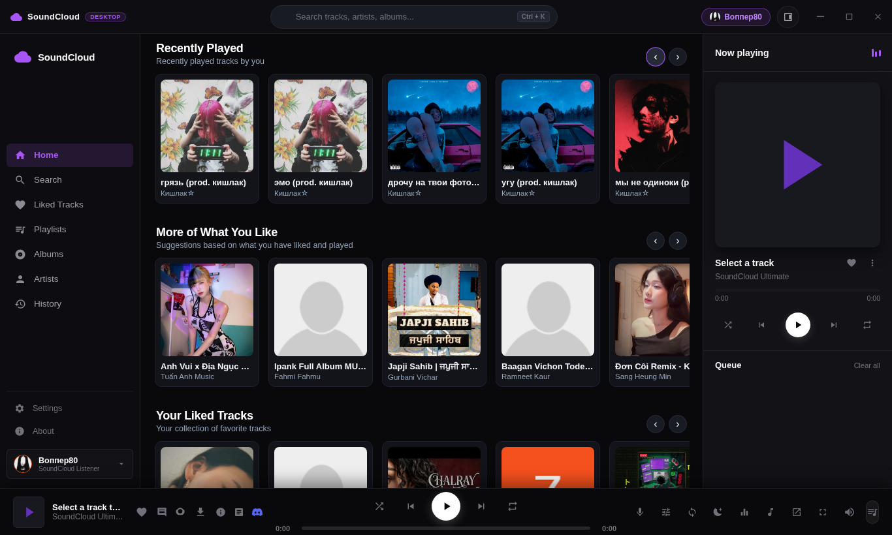
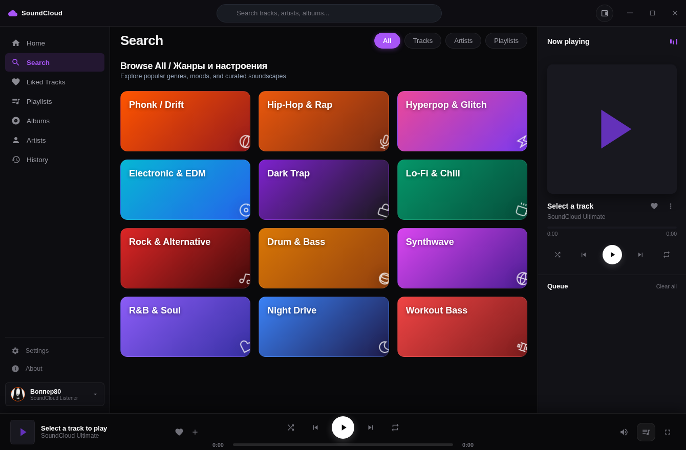
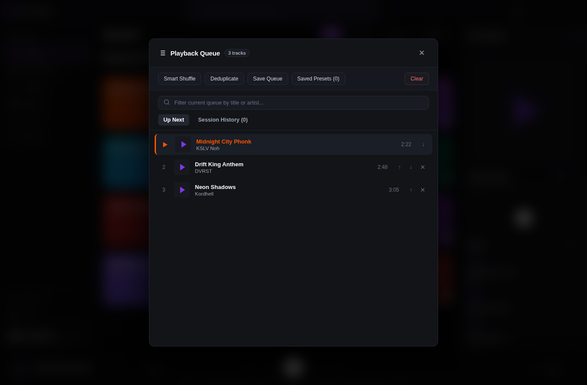
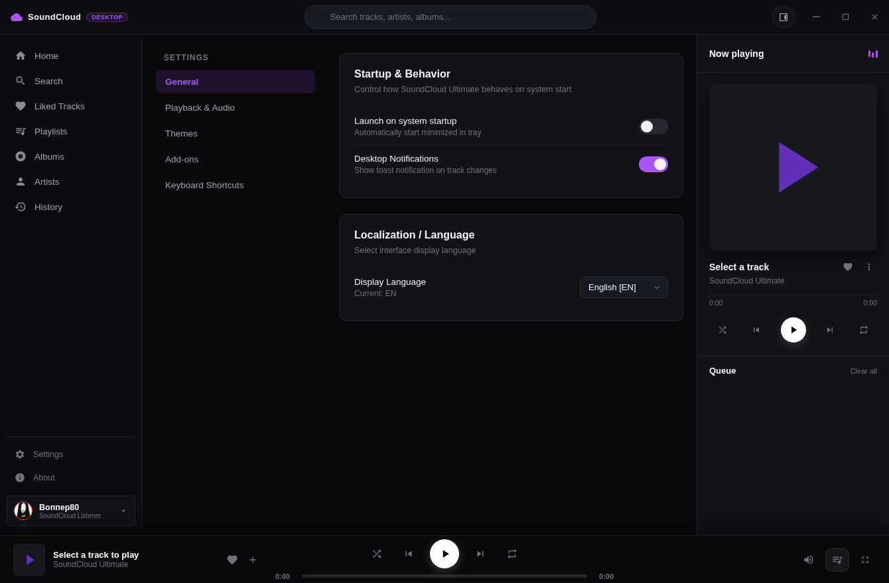
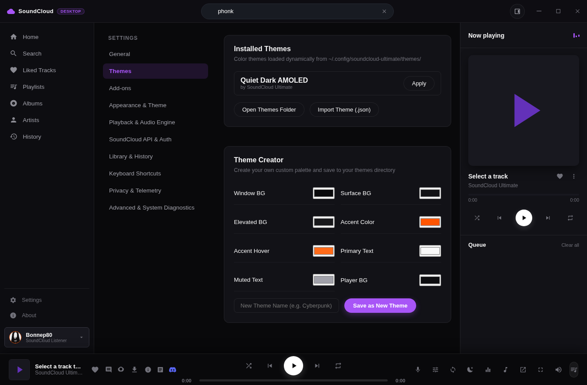
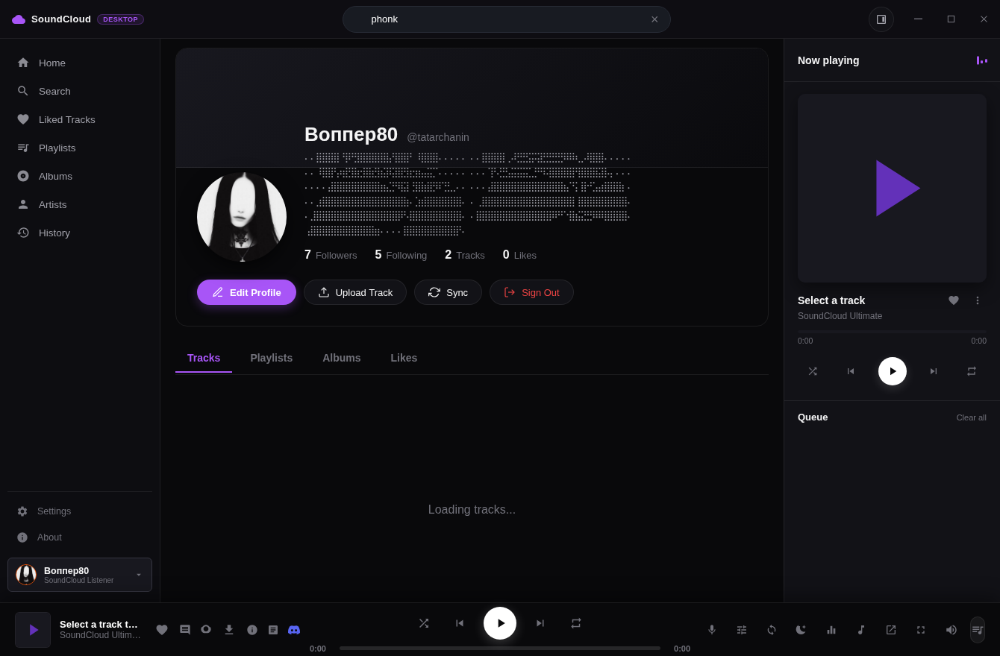
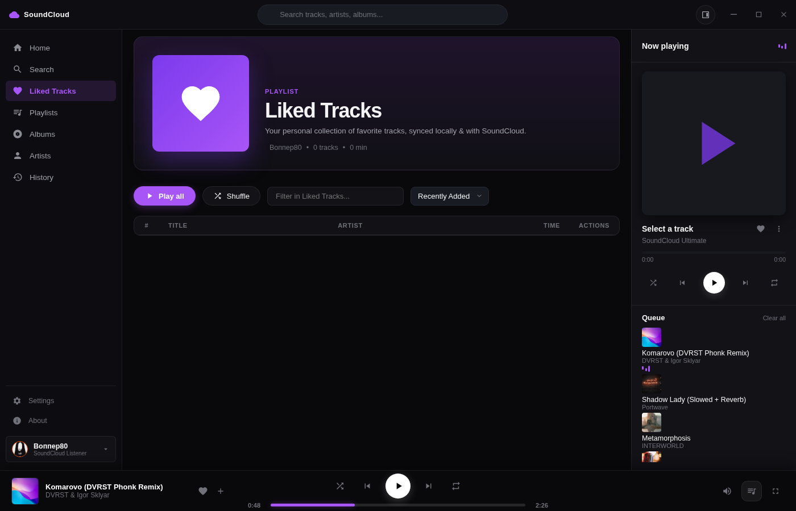
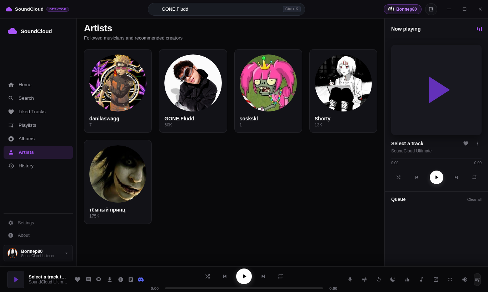

<div align="center">

# SoundCloud Ultimate (Quiet Dark AMOLED Edition)

[](https://github.com/masyaslasher/soundcloud-ultimate/releases/tag/v2.0.0)
[](https://www.rust-lang.org/)
[]()
[]()
[](LICENSE)

<p align="center">
  <strong>Language:</strong>
  <a href="README.md"><strong>English</strong></a> •
  <a href="README_RU.md">Русский (README_RU.md)</a>
</p>

<p align="center">
  <b>Next-generation standalone native desktop client for SoundCloud.</b><br>
  Engineered with a high-performance <b>Rust Workspace Core</b> (<code>sc-core</code>) and modern <b>Quiet Dark AMOLED</b> aesthetics (<code>#09090B</code> background, <code>#121418</code> surfaces, <code>#222630</code> borders, <code>#FF5500</code> brand accent).
  100% native desktop experience with zero browser dependencies.
</p>

</div>

---

## Modular Architecture

SoundCloud Ultimate is structured as an enterprise-grade Rust Cargo Workspace:

```text
SoundCloud-Ultimate/
├── crates/
│   └── sc-core/             # Pure Rust Core Library
│       ├── api.rs           # SoundCloud API v2 client, dynamic client_id resolution, multi-page cursor pagination
│       ├── audio.rs         # Rodio & Symphonia native stream decoding pipeline
│       ├── models.rs        # Strongly-typed serde data models (Track, User, Playlist, Collection)
│       ├── config.rs        # Cross-platform config & local library caching
│       └── discord.rs       # Native cross-platform Discord Rich Presence IPC
└── desktop/                 # Native Standalone Desktop Application
    ├── src/
    │   ├── main.rs          # Embedded Axum runtime, Tao + Wry native frameless CSD window
    │   └── soundcloud.rs    # Core API bridge & local audio streaming
    └── frontend/            # Quiet Dark AMOLED Single-Page Interface
        ├── index.html       # 4 Authentic Shelves, Search Categories, Fixed Player Dock
        ├── app.js           # Debounced unidirectional search, carousel navigation, audio player
        ├── queue_manager.js # Modern Quiet Dark queue engine (Smart Shuffle, Deduplicate, Presets)
        └── style.css        # Strict Quiet Dark AMOLED design tokens, zero leaking modals
```

---

## Interface Gallery

| Screen | Description | Preview |
| :--- | :--- | :--- |
| **Discover Home** | Authentic SoundCloud Discover feed featuring horizontal shelves (*Recently Played*, *Mixed for You*, *More of What You Like*, *Liked Tracks*, *Artists You Follow*) with carousel navigation. |  |
| **Search & Browse** | Real-time debounced search with category filters (*All*, *Tracks*, *Artists*, *Playlists*) and curated genre grid (*Phonk, Synthwave, Cyberpunk, Trap, Ambient*). |  |
| **Modern Playback Queue** | Quiet Dark queue panel with *Smart Shuffle* (artist repetition avoidance), *Deduplicate*, *Save Queue* presets, and instant track deletion. |  |
| **Settings & Audio** | Streamlined 5-tab settings hierarchy (*General*, *Playback & Audio*, *Themes*, *Add-ons*, *Keyboard Shortcuts*) with Quiet Dark selectors. |  |
| **Themes Studio** | Dynamic theme creator with real-time palette preview and instant JSON export/import. |  |
| **User Profile & Uploads** | Profile editor with avatar customization, bio editing, and native track upload capabilities. |  |
| **Liked Library** | Complete account library synchronization with full multi-page cursor pagination (>160 tracks), sort by date, and instant like toggle. |  |
| **Artists Directory** | In-app artist profiles, follower counts, avatar art, discographies, and instant profile navigation. |  |

---

## Key Highlights

- **Authentic SoundCloud Discover:** Clean horizontal carousel shelves without cluttered hero banners.
- **High-Performance Rust Core:** Powered by `reqwest`, `tokio`, and `sc-core` with automatic client_id rotation and resilient fallback streams.
- **Quiet Dark AMOLED Aesthetic:** Deep blacks (`#09090B`), subtle border contrast (`#222630`), elegant brand accent (`#FF5500`), and strictly pinned custom titlebar and player dock.
- **Modern Playback Queue:** Feature-complete queue management with drag-and-drop reordering, deduplication, and saved snapshots.
- **True In-App Modal Isolation:** All dialogs and popups remain strictly isolated (`position: fixed; inset: 0; z-index: 2000;`) until explicitly invoked, with three dismiss vectors (Escape, backdrop click, close button).
- **Native Discord Rich Presence:** Displays track title, artist, live elapsed/remaining progress bar, and cover art on your Discord profile.
- **Audio FX & Equalizer:** 5-band studio EQ, 360° 8D Audio spatializer, Nightcore/Slowed modes, and LRCLIB synchronized karaoke lyrics (`K`).

---

## Building & Running from Source

### Prerequisites

- **Rust:** 1.85+ (`curl --proto '=https' --tlsv1.2 -sSf https://sh.rustup.rs | sh`)
- **Linux Packages (Debian/Ubuntu):**
  ```bash
  sudo apt-get update
  sudo apt-get install -y libwebkit2gtk-4.1-dev libgtk-3-dev libsoup-3.0-dev libjavascriptcoregtk-4.1-dev libasound2-dev
  ```

### Build & Launch

```bash
# Clone the repository
git clone https://github.com/masyaslasher/soundcloud-ultimate.git
cd soundcloud-ultimate

# Build release binary for desktop
cargo build --release -p soundcloud-desktop

# Launch SoundCloud Ultimate
./target/release/soundcloud-desktop
```

---

## Package Distribution

Pre-compiled standalone packages are available under [GitHub Releases](https://github.com/masyaslasher/soundcloud-ultimate/releases/tag/v2.0.0):

- **Linux Standalone:** `soundcloud-ultimate-linux-x86_64-v2.0.0.tar.gz`
- **Debian / Ubuntu:** `soundcloud-ultimate_2.0.0_amd64.deb`
- **Linux AppImage:** `SoundCloud-Ultimate-v2.0.0-x86_64.AppImage`
- **Windows Portable:** `SoundCloud-Ultimate-Windows-x86_64-Portable.zip`

---

## License

This project is licensed under the [MIT License](LICENSE).
SoundCloud is a registered trademark of SoundCloud Global Limited & Co. KG. This project is an independent open-source client.
