# ☁️ SoundCloud Ultimate — Suite

[](https://github.com/masyaslasher/soundcloud-ultimate/releases/latest)
[](https://www.rust-lang.org/)
[-3DDC84.svg?logo=android&logoColor=white)](https://github.com/masyaslasher/soundcloud-ultimate/releases/latest)
[](LICENSE)
[]()
[]()

<p align="center">
  <strong>🌐 Язык / Language:</strong>
  <a href="README.md">English</a> •
  <a href="README_RU.md"><strong>Русский</strong></a>
</p>

> **SoundCloud Ultimate** — ультимативный нативный клиент нового поколения для прослушивания SoundCloud на ПК и Android.
> Сочетает премиальный дизайн **AMOLED Minimal Audio** (`#09090B`, фиолетовые акценты `#A855F7`), нативную скорость движка на Rust, **полностью автономное нативное окно без браузера**, отдельное приложение для **Android с фоновым воспроизведением и виджетом на экране блокировки**, встроенный студийный эквалайзер и 100% In-App социальную среду.

---

## 📦 Быстрая загрузка / Downloads (v1.3.0)

Готовые скомпилированные релизы доступны во вкладке [**GitHub Releases**](https://github.com/masyaslasher/soundcloud-ultimate/releases/latest):

| Платформа | Файл | Инструкция по запуску |
| :--- | :--- | :--- |
| 📱 **Android APK** | [**`SoundCloud-Ultimate.apk`**](https://github.com/masyaslasher/soundcloud-ultimate/releases/latest) | Полноценное Android-приложение: фоновое воспроизведение, виджет на экране блокировки и обход блокировок без VPN |
| 🪟 **Windows Native Portable** | [**`SoundCloud-Ultimate-Windows-x86_64-Portable.zip`**](https://github.com/masyaslasher/soundcloud-ultimate/releases/latest) | Распаковать архив и запустить `soundcloud-desktop.exe` (нативное окно WebView2, без запуска браузера) |
| 🪟 **Windows .EXE** | [**`SoundCloud-Ultimate-Portable.exe`**](https://github.com/masyaslasher/soundcloud-ultimate/releases/latest) | Автономный исполняемый файл для Windows |
| 🐧 **Linux AppImage** | [**`SoundCloud-Ultimate-x86_64.AppImage`**](https://github.com/masyaslasher/soundcloud-ultimate/releases/latest) | `chmod +x SoundCloud-Ultimate-x86_64.AppImage` и запустить (нативное окно WebKitGTK) |
| 🐧 **Debian / Ubuntu** | [**`soundcloud-ultimate_1.3.0_amd64.deb`**](https://github.com/masyaslasher/soundcloud-ultimate/releases/latest) | Установить пакет: `sudo dpkg -i soundcloud-ultimate_1.3.0_amd64.deb` |
| 🐧 **Linux Standalone** | [**`soundcloud-ultimate-linux-x86_64.tar.gz`**](https://github.com/masyaslasher/soundcloud-ultimate/releases/latest) | Распаковать: `tar -xvf soundcloud-ultimate-linux-x86_64.tar.gz && ./run.sh` |
| 🧩 **Chrome Extension** | [**`soundcloud-ultimate-chrome-extension-v1.3.0.zip`**](https://github.com/masyaslasher/soundcloud-ultimate/releases/latest) | Включить режим разработчика в `chrome://extensions` и нажать «Загрузить распакованное» |


---

## 📸 Галерея интерфейса / Screenshots

<div align="center">

### 1. Темы оформления: 10 разнообразных AMOLED Bento палитр
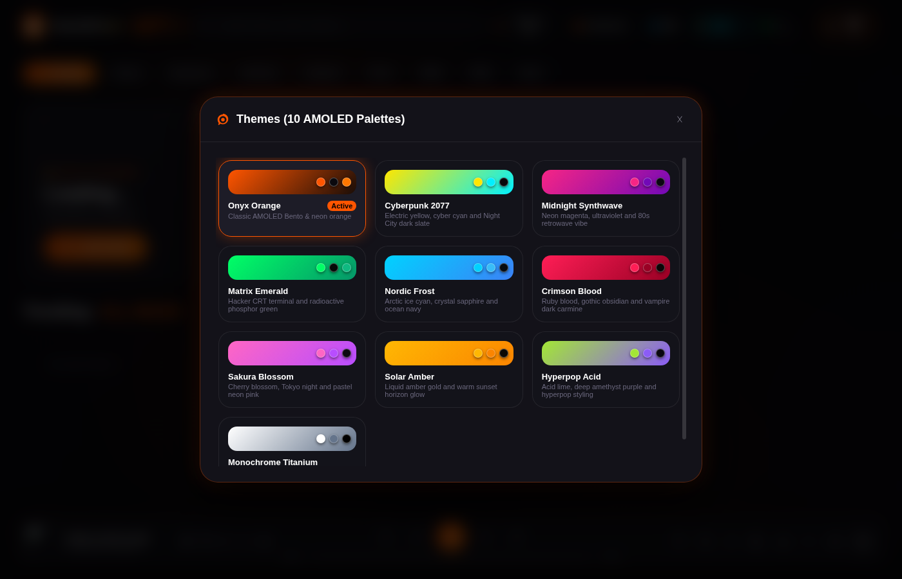

### 2. Центр встроенных расширений (Discord RPC, Караоке, FX Studio, Looper, Таймер сна, Bento-карточки)
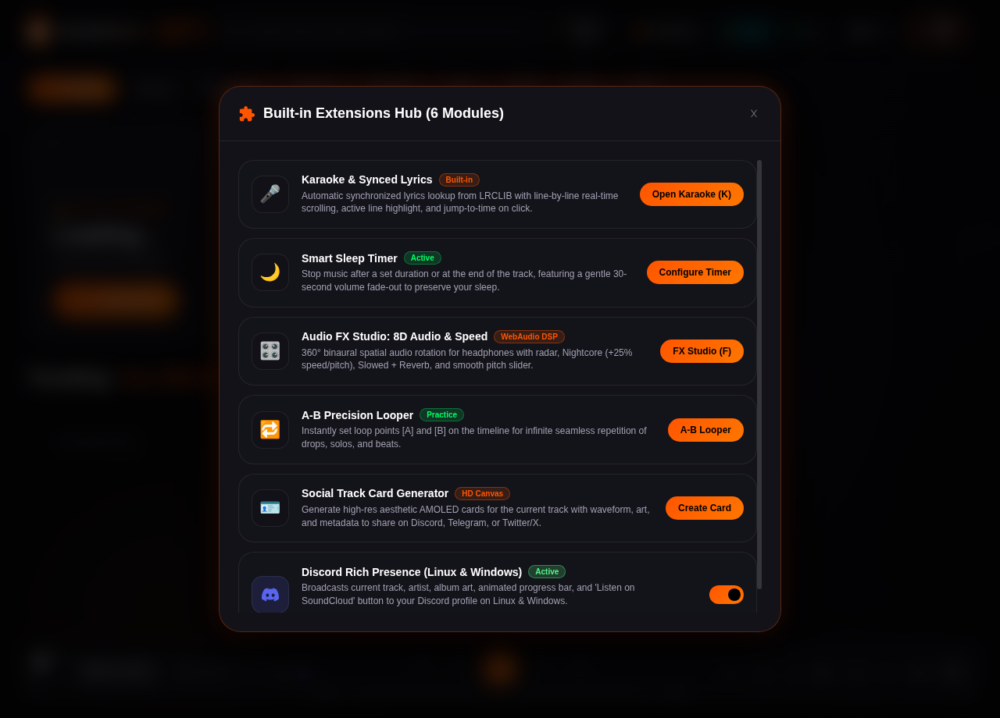

### 3. Синхронные тексты песен (Караоке LRCLIB) & A-B Looper в теме Nordic Frost
<p align="center">
  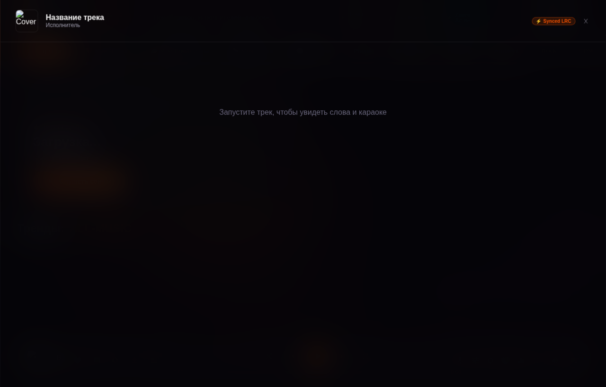
  &nbsp;&nbsp;
  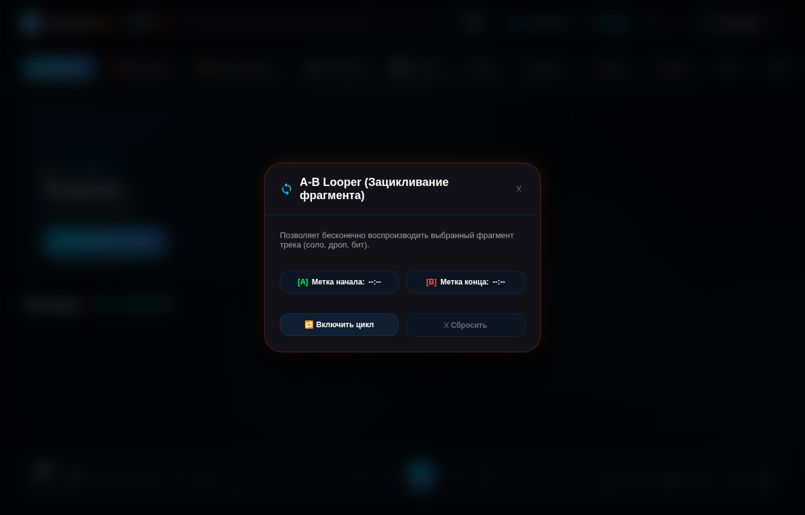
</p>

### 4. Cyberpunk 2077 Тема & Midnight Synthwave Тема
<p align="center">
  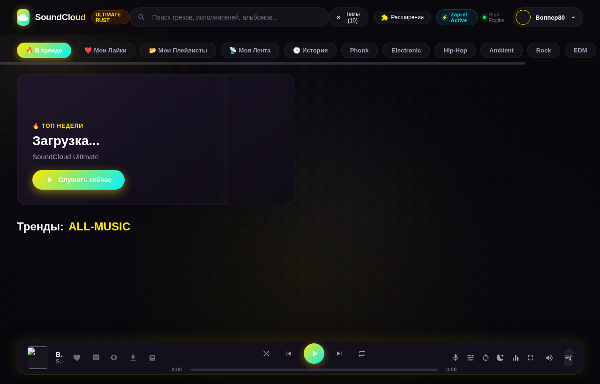
  &nbsp;&nbsp;
  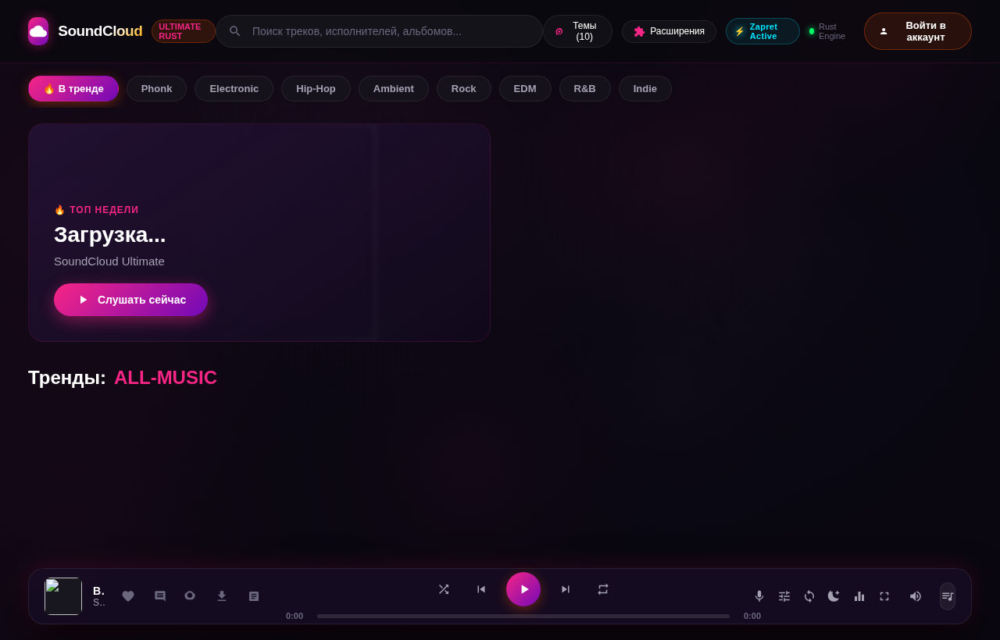
</p>

### 5. Студия эффектов: 8D Audio (360° Вращение) & Скорость (Nightcore, Slowed)
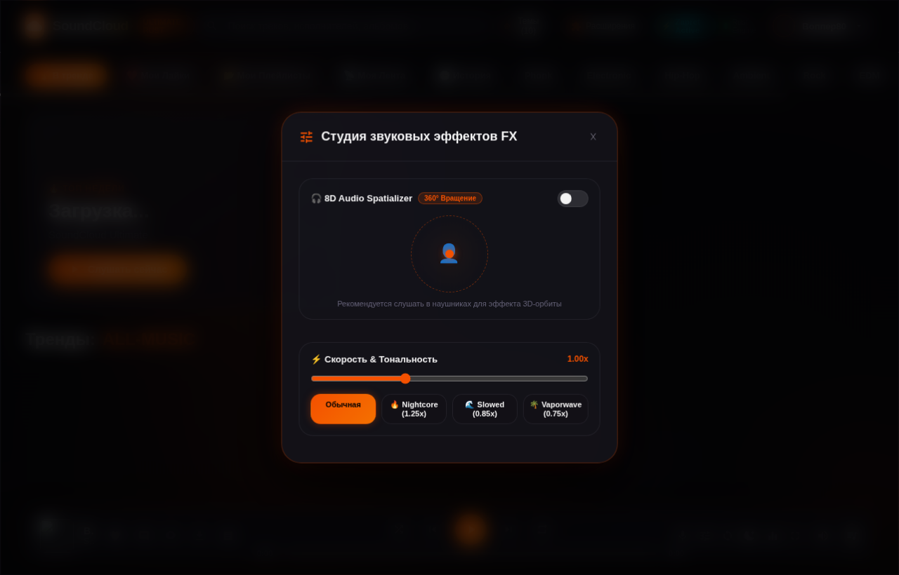

### 6. Генератор неоновых Bento-карточек трека для Discord, Telegram и VK
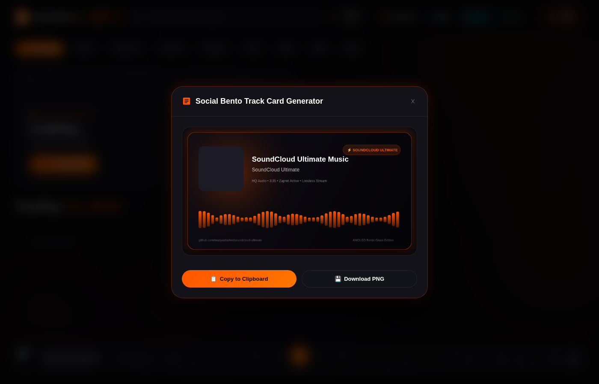

### 7. Главный экран рекомендаций и чартов (Discover & Trending)
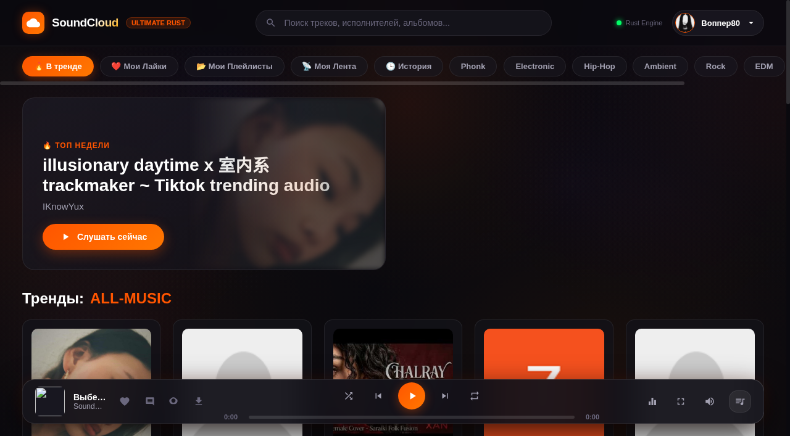

### 8. Встроенный профиль артиста с треками и кнопкой подписки (In-App Artist Profile)
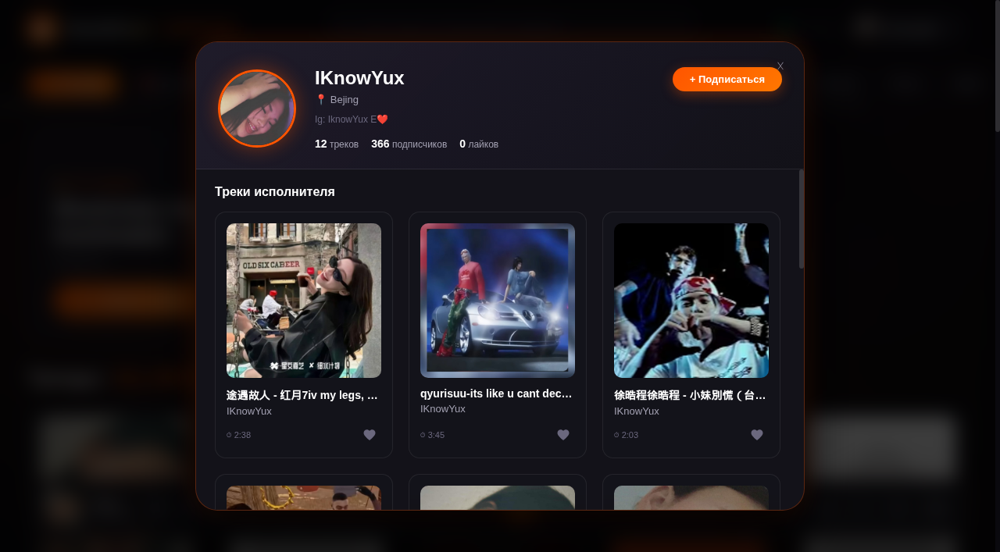

### 9. Инспектор альбомов и плейлистов (Playlist Inspector)
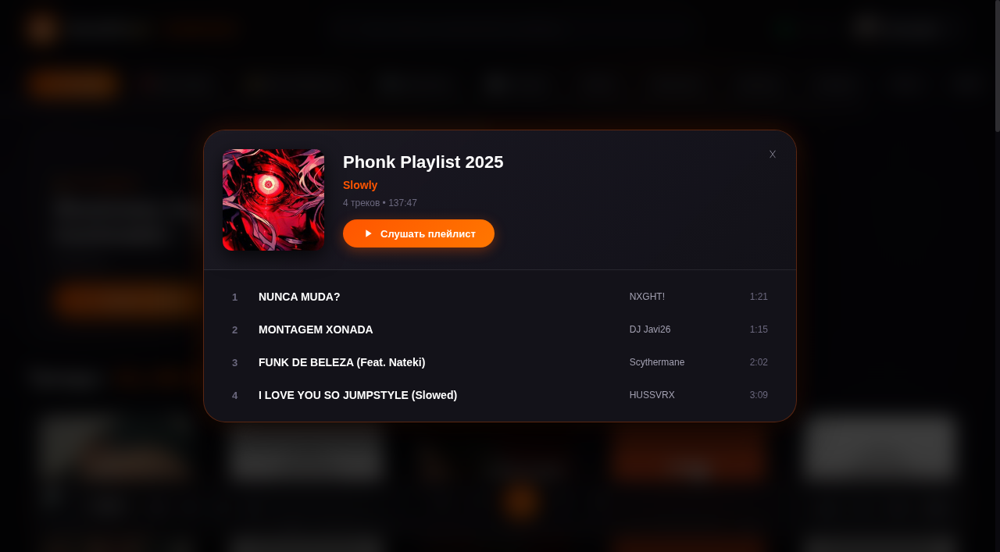

### 10. Комментарии с таймкодами и публикацией в реальном времени (Track Comments)
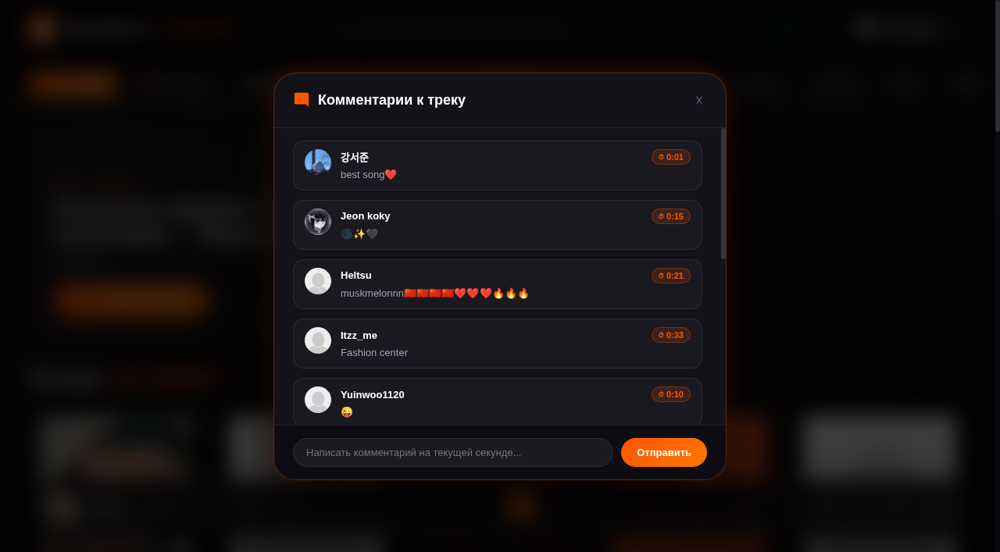

### 11. Лазерный Bento-ползунок громкости и Студийный эквалайзер
<p align="center">
  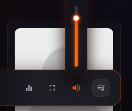
  &nbsp;&nbsp;&nbsp;&nbsp;
  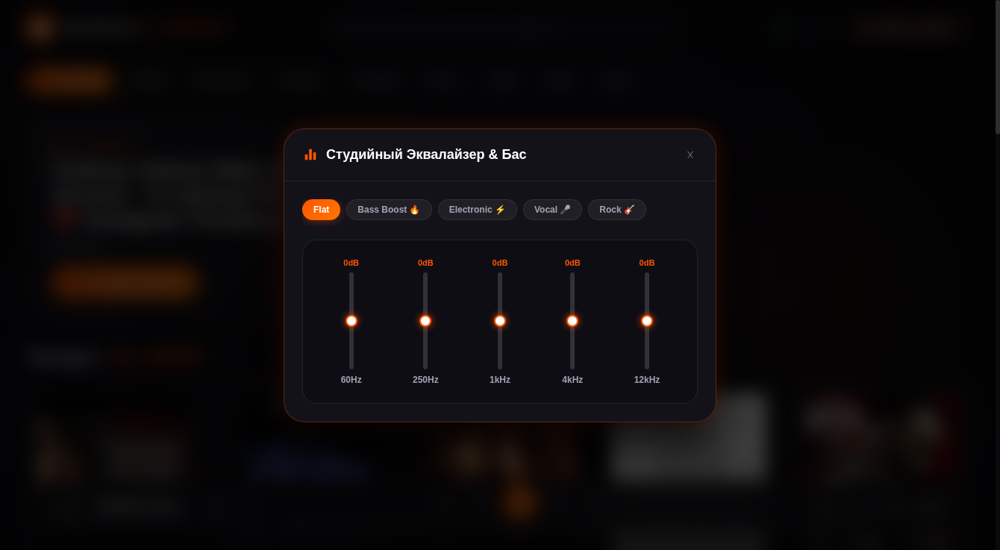
</p>

</div>

---

## 🎨 10 Встроенных тем оформления (AMOLED Bento Themes)

Переключение осуществляется мгновенно в 1 клик через кнопку **«Темы (10)»** в шапке плеера:

1. **🧡 Onyx Orange** — оригинальный AMOLED Bento Glass и лазерный неоновый оранж `#FF5500`.
2. **⚡ Cyberpunk 2077** — электрический кибер-желтый `#FFE600`, неон-циан `#00F0FF` и темный Night City.
3. **🌆 Midnight Synthwave** — неоновая маджента `#F72585`, глубокий ультрафиолет `#7209B7` и ретровейв 80-х.
4. **🟢 Matrix Emerald** — хакерский CRT-терминал, изумрудный фосфор `#00FF66` и темный матричный код.
5. **❄️ Nordic Frost** — арктический неоновый лед `#00D2FF`, кристальный сапфир и океанический глубокий синий.
6. **🩸 Crimson Blood** — кровавый рубин `#FF1E56`, готический вампирский обсидиан и темный кармин.
7. **🌸 Sakura Blossom** — цветущая сакура токийской ночи, пастельный неон `#FF66C4` и розовое золото.
8. **🍯 Solar Amber** — жидкое янтарь-золото `#FFB703`, закатный горизонт и теплые премиальные тона.
9. **🔮 Hyperpop Acid** — кислотный лайм `#A3E635`, глубокий аметистовый фиолет и гиперпоп-стиль.
10. **💎 Monochrome Titanium** — абсолютный оникс `#000000`, чистая платина `#FFFFFF` и титановый минимализм.

---

## 🧩 7 Встроенных расширений (Built-in Power Extensions)

1. **🎤 Караоке и Синхронный Текст Песни (`K`):**
   - Автоматический поиск текста трека в базе LRCLIB по исполнителю и названию.
   - Синхронная построчная прокрутка в реальном времени с подсветкой поющей строки.
   - Возможность перемотать воспроизведение кликом на любую строку текста.
2. **🌙 Умный Таймер Сна:**
   - Автоматическая остановка воспроизведения через 15, 30, 45, 60, 90 минут или «в конце текущего трека».
   - Мягкое 30-секундное затухание звука (fade-out), предотвращающее резкое прерывание музыки во сне.
   - Отображение оставшегося времени прямо на кнопке плеера (`🌙 24:18`).
3. **🎛️ Студия Эффектов FX (`F`):**
   - **8D Audio Spatializer (360°):** аппаратное бинауральное пространственное вращение стереобазы вокруг головы слушателя в наушниках с анимированным радаром.
   - **Nightcore Режим (1.25x):** увеличение скорости и подъем гармоник.
   - **Slowed + Reverb Режим (0.85x):** атмосферное замедление с глубоким басом.
   - **Vaporwave Режим (0.75x) и Плавный регулятор скорости (0.5x – 2.0x).**
4. **🔁 A-B Precision Looper (`[`, `]`, `\`):**
   - Установка метки начала `[A]` и метки конца `[B]` прямо во время прослушивания.
   - Визуальные маркеры и цветовая подсветка зацикленного фрагмента на таймлайне.
   - Бесшовное циклическое воспроизведение любимых битов, дропов или гитарных соло.
5. **🪪 Генератор Bento-Карточек Трека:**
   - Мгновенное создание AMOLED-карточки текущего трека на HTML5 Canvas под цвет активной темы.
   - Включает обложку, стилизованную аудио-волну, имя автора и lossless-бейдж.
   - Копирование изображения в буфер обмена или сохранение в PNG для публикации в Telegram, Discord, VK в 1 клик.
6. **🎮 Discord Rich Presence (Кроссплатформенная синхронизация для Linux и Windows):**
   - Чистый нативный клиент Discord IPC на Rust, встроенный непосредственно в ядро приложения без внешних зависимостей.
   - Полная поддержка Linux (Unix Domain Sockets: `/run/user/<uid>/discord-ipc-*`, `$XDG_RUNTIME_DIR`, Flatpak, Snap) и Windows (Named Pipes: `\\.\pipe\discord-ipc-*`).
   - Отображение в профиле Discord в реальном времени:
     - **Тип активности:** «Слушает SoundCloud» (Listening to ...)
     - **Название и автор:** Название текущего трека и исполнитель (`by ...`)
     - **Живой таймлайн:** Синхронизированные метки времени с интерактивным прогресс-баром
     - **Обложка высокого разрешения:** Оригинальный арт альбома и иконка SoundCloud
     - **Интерактивная кнопка:** «Listen on SoundCloud» для мгновенного перехода к треку
     - **Управление в интерфейсе:** Живой статус в центре расширений (`Active • Connected as @user`), авто-переподключение при открытии Discord и переключатель on/off.
7. **🌐 Центр Локализации на 8 Языков (`Alt+Shift+L`):**
   - Полная поддержка 8 языков интерфейса: Английский (🇺🇸 English), Русский (🇷🇺 Русский), Немецкий (🇩🇪 Deutsch), Французский (🇫🇷 Français), Японский (🇯🇵 日本語), Украинский (🇺🇦 Українська), Польский (🇵🇱 Polski) и Армянский (🇦🇲 Հայերեն).
   - AMOLED Bento-модальное окно выбора языка с флагами, национальными названиями и живыми индикаторами активности.
   - Вызов из Центра расширений, выпадающего меню профиля или по горячим клавишам `Alt + Shift + L`.
   - Главный экран и хедер остаются чистыми и минималистичными без отвлекающих плашек.

---

## ✨ Ключевые возможности / Core Features

### 🖥️ Полноценное нативное десктопное приложение (Rust + Tao + Wry)
- **Полная автономность от сторонних браузеров:** В отличие от решений на Electron или веб-ярлыков, десктопный клиент SoundCloud Ultimate теперь работает в собственном нативном системном окне на базе системного веб-движка (`wry`/`tao` с WebKitGTK в Linux и WebView2 в Windows). В диспетчере задач приложение отображается как единый процесс `soundcloud-desktop`, не запуская Chromium или вкладки браузера.
- **Высокопроизводительный движок на Rust:** Асинхронный сервер на Axum с прогрессивным кэшированием аудиопотоков.
- **100% In-App Экосистема:** Никаких перенаправлений на soundcloud.com. Профили артистов, альбомы, плейлисты, комментарии и похожие радиостанции открываются прямо внутри единого окна.
- **100% Гостевой режим и опциональный вход:**
  - Никакой принудительной авторизации: слушайте тренды, ищите любую музыку, используйте 8D Audio, караоке-тексты, эквалайзер и лупер без аккаунта.
  - Полноценные локальные избранные треки (`❤️ Мои Лайки`) и локальная история (`🕒 История`), сохраняемые на вашем устройстве даже без входа в аккаунт.
  - Вход в SoundCloud доступен в любой момент через авто-импорт в 1 клик или ручной ввод токена исключительно по вашему желанию.
- **Интеграция с аккаунтом SoundCloud (по желанию):**
  - ⚡ **Вход в 1 клик:** Автоматический импорт сохранённой веб-сессии Chromium/Chrome без ручного извлечения токенов.
  - ❤️ **Мои Лайки:** Моментальный доступ ко всей вашей библиотеке лайков.
  - 📂 **Мои Плейлисты:** Просмотр и воспроизведение личных подборок и альбомов.
  - 📡 **Моя Лента:** Персональная лента свежих релизов авторов, на которых вы подписаны.
  - 🕒 **История прослушиваний:** 30 последних треков вашего аккаунта.
- **Встроенные социальные функции:**
  - Подписка / отписка от артистов в один клик.
  - Быстрый лайк прямо во время прослушивания (`L`).
  - Просмотр комментариев слушателей на таймлайне и переход по таймкодам.
  - Публикация комментариев на текущей секунде воспроизведения.
  - 📻 **Радио-станции:** Мгновенный сбор 24 похожих рекомендаций на основе любого трека.
- **Студийный звук:**
  - Прямой стриминг HLS / AAC / MP3 потоков без задержек.
  - **5-полосный студийный эквалайзер:** 60Hz, 250Hz, 1kHz, 4kHz, 12kHz.
  - **Пресеты звучания:** *Bass Boost 🔥, Electronic ⚡, Vocal 🎤, Rock 🎸, Flat*.
  - Управление громкостью колесиком мыши с hover-мостом и плавной интерполяцией.
  - Скачивание треков в оригинальном качестве прямо из плеера (`D`).
- **Премиальный визуал:**
  - Полноэкранный неоновый виниловый визуализатор (`V`).
  - Процедурный шейдер дыма и тумана на HTML5 Canvas (60 FPS).
  - Интеграция с MediaSession API (управление клавишами на мультимедийной клавиатуре).

---

### 📱 Автономное мобильное приложение на Android (`SoundCloud-Ultimate.apk`)
- **🎧 Фоновое воспроизведение (Background Playback):**
  - Реализовано через Android `ForegroundService` и процессорный `PARTIAL_WAKE_LOCK`. Музыка непрерывно играет в фоне при выключенном или заблокированном экране, а также при работе с другими приложениями (Telegram, игры, браузер).
- **📲 Плеер на экране блокировки и в шторке уведомлений:**
  - Полноценная интеграция с AndroidX `MediaSessionCompat` и `NotificationCompat.MediaStyle`.
  - Управление воспроизведением: кнопки «Пауза / Плей», «Предыдущий», «Следующий трек», отображение названия композиции, имени исполнителя, обложки альбома и интерактивная шкала перемотки (seekbar).
- **🛡️ Встроенный DoH (Обход блокировок в РФ без VPN):**
  - Прямая интеграция OkHttp с защищенными DNS-over-HTTPS серверами Cloudflare (`1.1.1.1`) и Google (`8.8.8.8`).
  - Работает на всех мобильных операторах РФ (МТС, МегаФон, Билайн, Tele2) и домашних Wi-Fi сетях без необходимости включать VPN.
- **🖤 Адаптивный Bento Glass AMOLED интерфейс:**
  - Сенсорная адаптация жестов, чистый черный фон для экономии батареи на AMOLED/OLED матрицах, плавная анимация 60 FPS.
- **📦 Ультра-легкий вес:**
  - Готовый файл `SoundCloud-Ultimate.apk` весит всего **6.3 МБ**!

---

## 🛠️ Сборка из исходников / Build from Source

### Сборка Десктопного приложения (Rust)
```bash
git clone https://github.com/masyaslasher/soundcloud-ultimate.git
cd soundcloud-ultimate/desktop
cargo build --release
```
Скомпилированный бинарник будет находиться по пути: `target/release/soundcloud-desktop`.

### Сборка Android-приложения (APK)
```bash
cd soundcloud-ultimate/android
./gradlew assembleDebug
```
Скомпилированный APK будет находиться по пути: `app/build/outputs/apk/debug/app-debug.apk`.


---

---

## 🚀 Набор расширений SoundCloud Ultimate Expansion (v1.4.0)

Приложение SoundCloud Ultimate получило масштабное расширение профессионального уровня:

### 🎨 1. Студия тем и дизайн-токены (Theme Studio)
- **15 палитр оформления**: Minimal Graphite (графитовый минимализм), AMOLED Pure Black, Minimal Dark, Clean Light, Purple Minimal, а также 10 классических неоновых AMOLED палитр.
- **Полная кастомизация интерфейса**: ручной выбор цветов фона, поверхностей, дока, границ, акцентов и свечения.
- **Плотность интерфейса**: режимы Compact (компактный), Comfortable (стандартный) и Expanded (увеличенный).
- **Типографика и радиусы**: настройка шрифтов, скруглений углов (от строгих квадратных до круглых pill-кнопок).
- **Экспорт и импорт**: мгновенный предпросмотр без перезагрузки, сохранение в LocalStorage и перенос настроек через JSON.

### 📊 2. Персональная аналитика прослушиваний (Listening Analytics & Wrapped)
- **Локальный трекер событий**: безопасная фиксация истории воспроизведений, полных прослушиваний и пропусков без отправки наружу.
- **Интерактивные метрики**: общее время (в часах), уникальные треки, счетчик непрерывных дней прослушивания (streak) и самые активные часы.
- **Графики и тепловые карты**: векторный SVG-график активности, рейтинги любимых артистов, топы треков и распределение по жанрам.
- **Ежегодный отчет (Wrapped)**: генерация красивой карточки с итогами музыкального года.
- **Приватность**: экспорт данных в CSV и JSON, а также возможность полной очистки истории в 1 клик.

### ⚡ 3. Умные плейлисты (Smart Playlists)
- **Автоматические динамические подборки**: рассчитываются в реальном времени на основе ваших лайков, истории и очереди.
- **Встроенные умные миксы**:
  - *Забытые шедевры (Dusty Gems)*: лайкнутые треки, которые вы не слушали более 30 дней.
  - *На повторе (Heavy Rotation)*: треки с более чем 5 прослушиваниями.
  - *Свежие открытия (Fresh Discoveries)*: найденное за последнюю неделю.
  - *Короткие треки (Short Bops)*: энергичные композиции до 3 минут.
  - *Долгие сеты (Long Journeys)*: длинные миксы и сеты более 7 минут.
- **Конструктор правил**: создание собственных фильтров по названию, исполнителю, жанру, длительности и числу воспроизведений.

### 🧭 4. Движок рекомендаций и открытий (Discovery Engine)
- **Локальный алгоритм подбора**: интеллектуальный расчет вкусового профиля без платных внешних API.
- **4 канала открытий**: Похожие треки, Андерграунд (менее 25 тыс. прослушиваний), Забытое старое и Случайное погружение в жанры.
- **Интерактивная обратная связь**: кнопки «Больше такого» (👍), «Меньше такого» (👎) и «Скрыть» (👁️).

### 📑 5. Продвинутый менеджер очереди (Advanced Queue)
- **Drag-and-Drop перетаскивание**: ручной порядок треков с помощью удобных ручек захвата.
- **Умное перемешивание (Smart Shuffle)**: равномерно распределяет треки одних и тех же исполнителей.
- **Детектор дубликатов**: поиск повторов в очереди и удаление в 1 клик.
- **Именованные очереди**: сохранение текущего списка воспроизведения в именованные пресеты и быстрое восстановление.

### 🎛️ 6. 6-режимная студия визуализации звука (Audio Visualizer)
- **Прямой анализ WebAudio**: подключение через `AnalyserNode` (2048 FFT, 48 кГц) к реальному аудиопотоку без задержек.
- **6 режимов визуализации**:
  1. *Частотный спектр*: классический студийный эквалайзер-спектрограмма.
  2. *Осциллограф*: плавная неоновая волна времени в стиле CRT.
  3. *Радиальный круг*: круговые всплески частот на 360°.
  4. *Басовый пульс*: пульсирующие концентрические кольца, реагирующие на низкие частоты.
  5. *Стерео пик-метр (VU)*: аппаратные индикаторы громкости левого и правого каналов с пиковыми метками.
  6. *Минималистичная волна*: спокойная тонкая звуковая линия для концентрации.
- **Тонкие настройки**: регулятор чувствительности, ограничитель кадров (30 / 60 FPS для экономии заряда) и диагностика потока.

### 🔍 7. Инспектор треков и диагностика потоков (Track Inspector)
- **Детальные метаданные**: ID, дата релиза, статистика лайков, репостов и прослушиваний, лицензия и ссылки на SoundCloud.
- **Аудио-диагностика**: тип транскодинга (HLS `m3u8` / прогрессивный `mp3`), битрейт (128 kbps / 256 kbps HQ AAC) и статус Anti-DPI проксирования.
- **Raw JSON**: просмотр и копирование исходного ответа API SoundCloud.

### ⚡ 8. Живая системная телеметрия (Performance Monitor)
- **Метрики бэкенда**: эндпоинт Axum `/api/system/metrics`, отдающий точное потребление RSS памяти процессом, аптайм и параметры платформы.
- **Клиентская телеметрия**: реальный график частоты кадров (FPS), размер кучи JS Heap, запас буфера аудио в секундах.

### 🧩 9. Платформа плагинов и расширений (Plugin Studio SDK)
- **Изолированный runtime плагинов**: хуки жизненного цикла (`init`, `onTrackChange`, `destroy`).
- **3 встроенных плагина**:
  - *BPM Счетчик & Beat Tapper*: ручной расчет темпа тапами и определение ритма трека.
  - *Музыкальные факты и контекст*: интересные факты об артисте и корнях жанра прямо над панелью управления.
  - *Zen Focus Mode*: режим максимальной концентрации и сниженного контраста.
- **Импорт плагинов**: добавление пользовательских JavaScript плагинов в 1 клик.

### 🪟 10. Режим мини-плеера (Mini Player HUD)
- **Компактный плавающий плеер**: минималистичный виджет с обложкой, названием, бегунком времени и кнопками управления.
- **Быстрая клавиша `M`**: моментальное переключение между полным интерфейсом и мини-плеером.

---

## ⌨️ Горячие клавиши / Keyboard Shortcuts

| Клавиша | Действие |
| :---: | :--- |
| `Space` | Воспроизведение / Пауза |
| `←` / `→` | Перемотка трека на 5 секунд назад / вперед |
| `↑` / `↓` | Плавное изменение громкости (шаг 5%) |
| `M` | Режим мини-плеера (или Mute в строке ввода) |
| `I` | Инспектор трека и диагностика аудиопотока |
| `Q` | Открыть / закрыть менеджер очереди |
| `L` | Поставить / убрать лайк текущему треку |
| `D` | Скачать текущий трек на компьютер |
| `V` | Полноэкранный режим визуализатора |
| `E` | Открыть 5-полосный студийный эквалайзер |
| `K` | Открыть Караоке и Синхронный текст песни |
| `F` | Открыть Студию звуковых эффектов FX (8D Audio, Скорость) |
| `[` / `]` | Установить метки начала [A] и конца [B] в A-B Looper |
| `\` | Включить / выключить зацикливание A-B Looper |
| `C` | Открыть комментарии к играющему треку |
| `P` | Открыть профиль автора текущего трека |
| `H` | Открыть историю недавних прослушиваний |
| `S` | Фокус на строку поиска |
| `Esc` | Закрыть любое открытое модальное окно |

---

## 📄 Лицензия / License

Проект распространяется под открытой лицензией [MIT License](LICENSE).
Разработано с душой для истинных ценителей музыки и эстетики. 🧡

